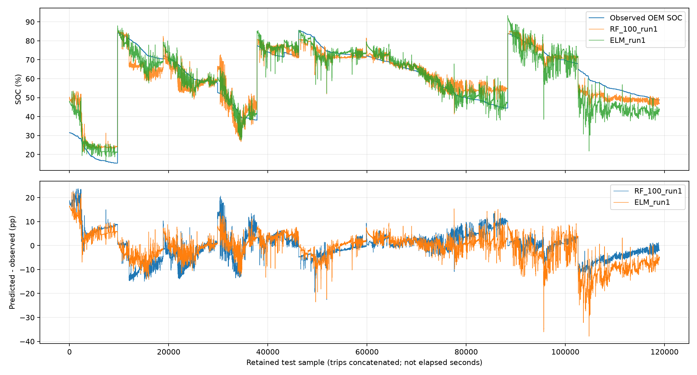

# BMW i3 battery SOC prediction

Trying to recreate the random forest model from [this paper](https://doi.org/10.1016/j.geits.2024.100177).

It takes battery voltage, current, battery temperature and outside temperature, then predicts the battery's charge percentage. There is also an ELM model to compare it with.

## Data

The dataset is included in `data/raw`, so you don't need to download anything separately. It has 70 BMW i3 trips. The first 60 are used for training and the last 10 for testing.

The data is **Battery and Heating Data in Real Driving Cycles** by Matthias Steinstraeter, Johannes Buberger and Dimitar Trifonov. [Original source](https://doi.org/10.21227/6jr9-5235) / [Kaggle copy](https://www.kaggle.com/datasets/atechnohazard/battery-and-heating-data-in-real-driving-cycles).

## Run it

Use Python 3.12 or newer:

```sh
pip install -r requirements.txt
python reproduce.py
python make_report.py results
```

This runs 25, 50, 75 and 100 trees, with 5 runs each and 5-fold validation. It takes a while. For a smaller run:

```sh
python reproduce.py --trees 25 --runs 1 --output results_quick
```

## Results

These are from the full run. RMSE is in battery charge percentage points; lower is better.

| Model | Best RMSE | Average RMSE |
|---|---:|---:|
| RF, 25 trees | 5.8825 | 5.9723 |
| RF, 50 trees | 5.8998 | 5.9323 |
| RF, 75 trees | 5.9149 | 5.9368 |
| RF, 100 trees | 5.8910 | 5.9262 |
| ELM | 5.9748 | 6.5802 |

The paper got 5.9028 for its best 25-tree result, so this came pretty close. Validation picked 100 trees in this version. The paper leaves out some settings, especially for ELM, so a few choices had to be made. The exact numbers won't all match.

The graphs and full comparison are in [results/REPORT.md](results/REPORT.md). Saved models and all test predictions are generated when you run the code.



To check the results after running:

```sh
python verify_results.py results
```
