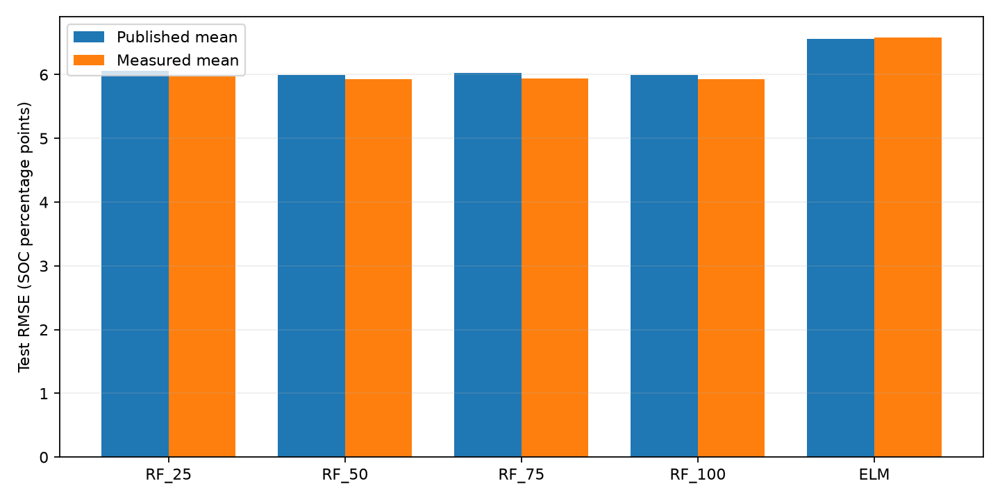

# Reproduction results

Measured results from the downloaded BMW i3 dataset. Published values are references, not substituted measurements.

Training samples: 945,026; test samples: 118,974. Runs per configuration: 5. CV: row.

## Held-out test results

All errors are SOC percentage points. Best here means the minimum of that metric across runs, matching the table-style summary; minima can belong to different runs.

| Model | Paper best RMSE | Measured min RMSE | Paper mean RMSE | Measured mean RMSE | Measured mean MAE |
|---|---:|---:|---:|---:|---:|
| RF_25 | 5.9028 | 5.8825 | 6.0622 | 5.9723 | 4.4773 |
| RF_50 | 5.9256 | 5.8998 | 5.9992 | 5.9323 | 4.4496 |
| RF_75 | 5.9949 | 5.9149 | 6.0226 | 5.9368 | 4.4442 |
| RF_100 | 5.9547 | 5.8910 | 5.9895 | 5.9262 | 4.4351 |
| ELM | 6.3127 | 5.9748 | 6.5647 | 6.5802 | 4.9779 |

Selected tree count: 100, based on mean validation RMSE.

## Validation and interpretation

- 25 trees: mean fold RMSE 0.9896 across 25 fitted folds.
- 50 trees: mean fold RMSE 0.9788 across 25 fitted folds.
- 75 trees: mean fold RMSE 0.9742 across 25 fitted folds.
- 100 trees: mean fold RMSE 0.9714 across 25 fitted folds.

Row-shuffled CV mixes neighboring samples from a trip and is optimistic relative to evaluation on unseen trips. Only training CV determines tree selection. The ten test trips remain separate.

## Reproduction limits

The cleaned test count matches the paper exactly. Training has one fewer row (945,026 versus 945,027). Raw time steps are approximately 0.1 seconds rather than the stated 1 Hz. RF leaf size, feature subsampling, depth, seeds, missing-data policy and folds are assumed. The ELM architecture is unspecified in the paper, so the implemented ELM is a transparent baseline rather than an exact reconstruction. MATLAB and scikit-learn implementations differ. See README.md for all choices and sources.

The paper has inconsistent best/average entries and mixed decimal separators. Published values in paper_results.json are transcribed interpretations, not claims that the experiment was replicated bit-for-bit.

## Figures

